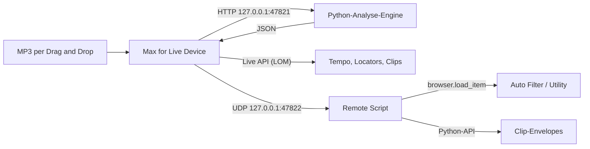

# Loop Sketch (Ableton Live 11) + Reference Rebuilder

## Loop Sketch (Hauptprodukt)

**Loop Sketch** ist ein Max-for-Live Arrangement-Tool im Stil von Song Sketch: eigene Genre-Templates
(JSON), Session-Szene-1-Loops den Roles zuordnen, **To Arr** legt die Loops als Kacheln ins Arrangement
und setzt Locators. Keine MP3-Analyse, kein Demucs — nur deine Loops × Template-Presence.

| Teil | Ordner | Aufgabe |
|---|---|---|
| Templates | `templates/` | Techno×3, House×2, Tech House×1 — Sections + Role-Presence |
| M4L-Device | `m4l/LoopSketch/` | UI: Template, Role→Spur, Spuren, **To Arr** |
| Logik | `m4l/js/ls_*.js` + `live_bridge.js` | Planen, `place_loop`, Locators |
| Remote Script | `remote_script/LoopSketch/` | Optional (Ping/UDP 47823); To Arr braucht es nicht |
| Installer | `install.sh` | Device + Templates + Remote Script |

### Installation (Loop Sketch)

```bash
./install.sh
# Live neu starten → Device „LoopSketch“ aus der User Library auf eine Spur
```

### Bedienung

1. In **Session-Szene 1** pro Spur einen Loop ablegen (MIDI oder Audio, typisch 8 Takte).
2. Device **Loop Sketch** laden → Template wählen (z. B. Techno Warehouse).
3. **Role → Spur**: Auto nach Namen (Kick, Bass, Hats, …) oder Menü; **Spuren** aktualisiert die Liste.
4. **To Arr**: Für jede gemappte Role wird der Scene-1-Clip über alle **aktiven** Template-Regionen
   gekachelt (`place_loop` → Noten/Audio + Farbe bleiben). Locators an den Abschnittsanfängen.
5. Optional: Toggle **BPM-Hinweis setzen** übernimmt `bpm_hint` aus dem Template.

### Templates

Eigene JSON unter `templates/` (siehe bestehende Dateien). Pflichtfelder: `id`, `name`, `genre`,
`sections[]` (`start_bar`, `length_bars`, `label`), `roles` mit `presence` (bool pro Section) oder
`active_bars` (`[start, end)` in Takten) für kick/bass/hats/perc/synth/pad/fx.

### Tests

```bash
node --test m4l/tests/ls_*.test.js
node m4l/tests/dry_loop_sketch.js
python3 -m pytest tests/test_installer.py m4l/tests/test_ls_device.py -q
python3 m4l/LoopSketch/build_device.py   # nach UI-Änderungen
```

Retest in Live: [`docs/retest-loop-sketch-de.md`](docs/retest-loop-sketch-de.md).

---

## Reference Rebuilder (älterer Pfad, optional)

Ein Max-for-Live-Device, das eine Referenz-MP3 analysiert und daraus im aktuellen Live-Set ein
**spielbares Arrangement in voller Referenzlänge** baut. Bleibt im Repo; **nicht** der Default-Install.

```bash
./install.sh --with-reference-rebuilder   # Device + Remote Script
./install.sh --with-engine                # inkl. Demucs-Engine
```



| Teil | Ordner | Aufgabe |
|---|---|---|
| Analyse-Engine | `engine/` | Tempo/Beatgrid, Songteile, Stems (Demucs), Automationskurven, FastAPI-Dienst |
| M4L-Device | `m4l/` | Oberfläche, Engine-Anbindung, Umsetzung im Live-Set |
| Remote Script | `remote_script/ReferenceRebuilder/` | Lädt Geräte über die Browser-API, schreibt Clip-Envelopes |
| Installer | `install.sh`, `start-engine.sh` | Einrichten, Kopieren, Engine starten |

## Voraussetzungen

- macOS (Apple Silicon oder Intel)
- Ableton Live 11 Suite (oder Standard + Max for Live). Max 8 mit Node for Max ist in Live 11 enthalten.
- Internetzugang bei der Installation (uv, Python-Pakete, Demucs-Modell). Mit Demucs braucht die
  Installation etwa 1–2 GB Platz (PyTorch).

### Reference Rebuilder — Installation & Bedienung

Siehe Abschnitte unten bzw. ältere Checkliste [`docs/test-checkliste-live11.md`](docs/test-checkliste-live11.md).
Kurz: Control Surface **ReferenceRebuilder**, Device laden, MP3 analysieren, **Anwenden** kachelt Loops
über die Referenzlänge (optional Automation via Remote Script).

## Analyse-Engine einzeln nutzen

```bash
cd engine
uv run reference-engine analyze ~/Music/referenz.mp3 -o analyse.json   # JSON ausgeben
uv run reference-engine serve                                           # HTTP-Dienst auf 127.0.0.1:47821
# oder aus dem Repo-Ordner:  ./start-engine.sh --foreground
```

HTTP-Schnittstelle (nur localhost):

| Methode | Pfad | Zweck |
|---|---|---|
| `GET` | `/health` | Status, Version, ob Demucs installiert ist |
| `POST` | `/jobs` `{"path": "...", "separation": "auto\|demucs\|bands"}` | Analyse im Hintergrund starten |
| `GET` | `/jobs/{id}` | Fortschritt bzw. Ergebnis |
| `POST` | `/analyze` | Analyse synchron (gleicher Body) |
| `POST` | `/analyze/upload` | Analyse einer hochgeladenen Datei (multipart) |

Das Ergebnis folgt `engine/src/reference_engine/schema/analysis.schema.json`: `tempo`, `sections`,
`stems[].automation[]` (Breakpoints in Beats), `stems[].active_sections`, `suggested_devices`, `hints`
(z. B. Sidechain-Pumpen) und `warnings`.

Verfahren in Kürze: Fourier-Tempogramm mit metrischer Bewertung und Prior für elektronische Musik
(~128 BPM; optional `bpm_hint` / `bpm_min`/`bpm_max` per API/CLI), Taktanfang über Takt-zu-Takt-Klangwechsel;
Segmentierung per dynamischer Programmierung auf dem 4-Takt-Raster (bevorzugt 8/16/32), Labels über
Kick/Bass/Energie (Breakdown = ohne Kick, Build = ansteigend); Demucs-Stems (`htdemucs`, Gerät: MPS → CUDA → CPU)
plus spektrale Element-Masken (Kick/Bass/Clap/Hats/Ride/Perc/Atmo/Synth/Vocals) mit Presence pro Takt und
Filter-/Gain-Kurven; Sidechain-Hinweis aus beat-synchroner Pegelmodulation. Fortschritt während Demucs
wird gemeldet; Stems landen im Cache.

Umgebungsvariablen: `REFERENCE_ENGINE_DEMUCS_DEVICE` (sonst automatisch `mps`/`cuda`/`cpu`),
`REFERENCE_ENGINE_DEMUCS_MODEL` (Standard `htdemucs`), `REFERENCE_ENGINE_CACHE`.

## Ports

| Port | Protokoll | Wer |
|---|---|---|
| 47821 | HTTP | Analyse-Engine (Device → Engine) |
| 47822 | UDP/JSON | Remote Script (Device → Remote Script) |

Andere Ports: `config.json` anpassen; für das Remote Script zusätzlich `PORT` in `server.py`.

## Entwicklung und Tests

```bash
node --test m4l/tests/ls_*.test.js           # Loop Sketch (Templates + To Arr)
node m4l/tests/dry_loop_sketch.js
python3 -m pytest tests/test_installer.py m4l/tests/test_ls_device.py -q
cd engine && uv sync && uv run pytest        # RR-Engine + Legacy-Tests
node --test m4l/tests/*.test.js              # inkl. Reference Rebuilder
python3 m4l/LoopSketch/build_device.py       # Loop Sketch Device
python3 m4l/build_device.py                  # Reference Rebuilder Device
```

- Die Engine-Tests erzeugen synthetische Songs (`engine/tests/synth.py`) und Hardgroove-Signale
  (`engine/tests/groove.py`, u. a. 147 BPM mit dichter Percussion gegen 2/3-Tempo-Fehler) und prüfen Tempo,
  Elemente (Kick vs. Bass, Ride, Clap, Pad), Songteile, Vorschläge und einen JSON-Snapshot
  (`UPDATE_SNAPSHOTS=1` aktualisiert ihn).
- Die Device-Tests führen `live_bridge.js` gegen ein nachgebautes Live-11-Objektmodell aus
  (`m4l/tests/fake_lom.js`) – inklusive kompletter Abläufe „Analysieren → Anwenden“.
- Das Device wird aus `m4l/build_device.py` erzeugt; `ReferenceRebuilder.maxpat` ist dieselbe Patcher-Datei
  zum Öffnen in Max.

Aufbau des Devices: `rr_node.js` (Node for Max) enthält Ablauf und Netzwerk, `rr_core.js` die reine Logik,
`live_bridge.js` (klassisches Max-`[js]`, ES5) führt einzelne Live-API-Operationen aus.

## Bekannte Grenzen

- **Audiospuren:** Live 11 kann per API keine leeren Audio-Clips anlegen. Clip-Gerüst und Automation gibt es
  daher nur auf MIDI-Spuren; auf Audiospuren werden nur die Effekte eingefügt.
- **Arrangement wird überschrieben:** `duplicate_clip_to_arrangement` ersetzt vorhandenes Material an
  derselben Stelle der Spur. Am besten in ein leeres Arrangement bzw. auf leere Spuren bauen.
- **Taktart:** Es wird 4/4 angenommen; Tempowechsel innerhalb der Referenz werden nicht abgebildet.
- **Ohne Demucs** (`--no-stems`) entfallen Vocals; Elemente kommen aus dem Mix (Kick/Bass-Trennung und
  Atmo/Synth sind ungenauer). Mit Demucs bleiben Drum-Unterelemente spektral (kein separates Drumsep-Modell).
- **Heuristiken:** Songteil-Namen und Sweep-/Fade-Erkennung sind Heuristiken und müssen bei echten Songs ggf.
  von Hand korrigiert werden.
- **Effekte:** In dieser Version nur Auto Filter (Frequency) und Utility (Gain). Sidechain wird nur als
  Hinweis gemeldet, nicht eingerichtet.
- Die Stem-Zuordnung in den Menüs wird nicht mit dem Set gespeichert (die Optionen schon).
- Ist im Browser „Hot-Swap“ aktiv, kann `load_item` ein Gerät ersetzen statt anzuhängen.

## Fehlerbehebung

| Problem | Lösung |
|---|---|
| „Engine nicht erreichbar“ | `./start-engine.sh --foreground` im Terminal starten und Fehlermeldung lesen; Log: `~/Library/Logs/ReferenceRebuilder/engine.log` |
| „Remote Script antwortet nicht“ | Control Surface aktiv? Live neu gestartet? `Log.txt` unter `~/Library/Preferences/Ableton/Live 11.x/` nach „ReferenceRebuilder“ durchsuchen |
| Device lädt nicht / JS-Fehler | Max-Konsole öffnen (Device bearbeiten › Window › Max Console); liegen alle `.js` neben der `.amxd`? |
| `.amxd` wird von Live nicht angenommen | Leeres *Max Audio Effect* einfügen, bearbeiten, in Max `ReferenceRebuilder.maxpat` öffnen, Inhalt kopieren, ins leere Device einfügen, als `ReferenceRebuilder.amxd` im Device-Ordner speichern |
| Locators/Clips an falscher Stelle | Referenz beginnt nicht auf Takt 1: `first_downbeat_sec` in der Zusammenfassung/JSON beachten |

Die manuelle Test-Checkliste für Live 11 auf dem Mac steht in
[`docs/test-checkliste-live11.md`](docs/test-checkliste-live11.md).
