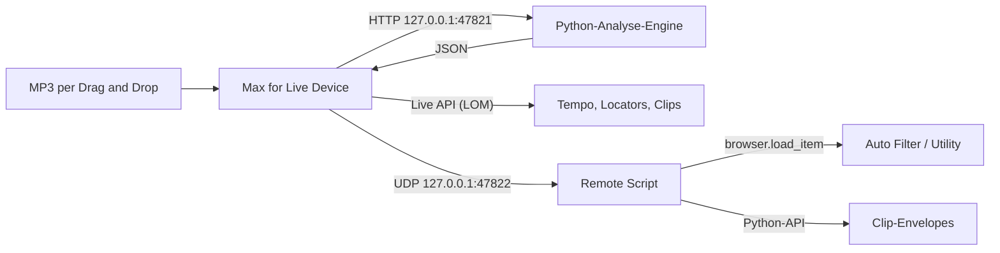

# Ableton Reference Rebuilder (Live 11 Suite, macOS)

Ein Max-for-Live-Device, das eine Referenz-MP3 analysiert und daraus im aktuellen Live-Set ein
**spielbares Arrangement in voller Referenzlänge** baut: Tempo, benannte Locators, und den
**~8-Takt-Loop** jeder zugeordneten Spur (Session- oder Arrangement-Clip am Spuranfang) **über die
gesamte Tracklänge gekachelt** – **MIDI-Noten und Farbe des Original-Loops bleiben**. Zusätzlich
optional **Automationen** (Filter-Cutoff / Utility-Gain). Fehlende Effekte und Clip-Envelopes erledigt
ein kleines **Companion Remote Script**, weil Max for Live in Live 11 weder Geräte einfügen noch
Clip-Envelopes anlegen kann (`Clip.automation_envelope` gibt es nur in der Python-API).

Es werden **keine leeren MIDI-Clips** erzeugt und keine neuen Sounds erfunden – nur deine Loops,
wiederholt bis zur Referenzdauer (auch wenn die MP3-Analyse dünn oder falsch ist).



| Teil | Ordner | Aufgabe |
|---|---|---|
| Analyse-Engine | `engine/` | Tempo/Beatgrid, Songteile, Stems (Demucs), Automationskurven, FastAPI-Dienst |
| M4L-Device | `m4l/` | Oberfläche, Engine-Anbindung, Umsetzung im Live-Set |
| Remote Script | `remote_script/ReferenceRebuilder/` | Lädt Geräte über die Browser-API, schreibt Clip-Envelopes |
| Installer | `install.sh`, `start-engine.sh` | Einrichten, Kopieren, Engine starten |

## Voraussetzungen

- macOS (Apple Silicon oder Intel)
- Ableton Live 11 Suite (oder Standard + Max for Live). Max 8 mit Node for Max ist in Live 11 enthalten.
- Internetzugang bei der Installation (uv, Python-Pakete, Demucs-Modell). Mit Demucs braucht die
  Installation etwa 1–2 GB Platz (PyTorch).

## Installation

```bash
git clone <dieses-repo> ~/ReferenceRebuilder
cd ~/ReferenceRebuilder
./install.sh            # mit Demucs (empfohlen)
# ./install.sh --no-stems   # ohne Demucs: schneller, aber nur grobe Stem-Trennung ohne Vocals
```

Das Skript

1. installiert bei Bedarf [uv](https://docs.astral.sh/uv/) und richtet die Engine in `engine/.venv` ein,
2. lädt das Demucs-Modell `htdemucs` vor,
3. kopiert das Remote Script nach `~/Music/Ableton/User Library/Remote Scripts/ReferenceRebuilder`,
4. kopiert das Device samt JavaScript nach
   `~/Music/Ableton/User Library/Presets/Audio Effects/Max Audio Effect/Reference Rebuilder`,
5. schreibt `~/Library/Application Support/ReferenceRebuilder/config.json` (Ports, Startbefehl der Engine).

Liegt deine User Library woanders (Live: *Einstellungen › Library*), so:
`RR_USER_LIBRARY="/Pfad/zur/User Library" ./install.sh`. Deinstallieren: `./install.sh --uninstall`.

### Control Surface aktivieren

1. Live 11 neu starten.
2. *Einstellungen › Link/Tempo/MIDI › Control Surface*: in einer freien Zeile **ReferenceRebuilder**
   wählen, Eingang und Ausgang auf **Keine** lassen.
3. Unten in der Statusleiste erscheint kurz „Reference Rebuilder bereit (UDP 47822)“.

## Bedienung

1. Device **Reference Rebuilder** aus der User Library auf eine beliebige Spur ziehen (z. B. Master oder eine
   eigene „Referenz“-Audiospur).
2. MP3 auf das Drop-Feld ziehen und **Analysieren** klicken. Die Engine wird bei Bedarf automatisch gestartet;
   mit Demucs dauert die Analyse je nach Mac einige Minuten (Fortschritt in der Statuszeile). Ergebnisse
   werden pro Datei zwischengespeichert (`~/.cache/reference-rebuilder`).
3. Rechts erscheinen Tempo, Songteile (z. B. Intro, Build, Drop, Breakdown, Outro), die Zuordnung der
   Elemente zu deinen Spuren und Effekt-Vorschläge.
4. **Element → Spur**: Die Zuordnung erfolgt automatisch nach Spurnamen
   (Kick, Bass, Clap/Snare, Hats, Ride, Perc, Atmo/Pads, Synth/Lead, Vocals) und lässt sich pro Element
   im Menü ändern („Keine“ = ignorieren). **Spuren** aktualisiert die Liste.
5. Optionen:
   - **Arrangement anlegen**: Locators + deine Loops über die **volle Referenzlänge** kacheln
     (Presence-Stille nur optional; bei dünner Analyse trotzdem durchgehend spielbar)
   - **Automation/Effekte**: fehlende Auto Filter/Utility einfügen und Kurven schreiben
   - **Tempo übernehmen**: Song-Tempo auf das erkannte Tempo setzen
6. **Anwenden** klicken. Die Statuszeile meldet am Ende, was angelegt wurde; Hinweise (z. B. Spur ohne
   Loop am Anfang) stehen im Textfeld. Schlägt ein einzelner Schritt fehl, läuft Anwenden weiter
   („Hinweise beim Anwenden“).

**Tipp:** Vorher das Set speichern bzw. eine Kopie anlegen. Jede Änderung ist ein eigener Undo-Schritt.
Pro Spur sollte am Anfang ein brauchbarer Loop liegen (Session-Slot oder Arrangement-Clip bei Takt 1,
typisch 1–8 Takte) – den nutzt Anwenden als Quelle.

### Was im Set passiert

- **Tempo** wird gesetzt, **Locators** werden an den Songteil-Anfängen gesetzt und benannt (Beat 0 = erster
  erkannter Taktanfang der Referenz; die Referenz-Audiodatei ggf. um `first_downbeat_sec` nach links schieben).
  Ein bereits vorhandener Locator an derselben Position wird nur umbenannt.
- Für jede zugeordnete Spur mit erkanntem **Quell-Loop** wird dieser Clip **über die volle
  Referenzlänge gekachelt** (Dauer aus Analyse: Abschnittsende / `duration_sec`×BPM / `num_bars`,
  das Maximum), behält **Noten und Farbe des Originals**. Presence-basierte Stille ist optional und
  greift nur bei belastbarer Presence; sonst durchgehende Kachelung. MIDI- und Audiospuren
  funktionieren, solange ein Loop existiert. Fehlt der Loop, erscheint ein Hinweis und die Spur
  bekommt keine Arrangement-Clips.
- **Automation** (optional): Nur bei **hörbarer** Kurve (nicht flach/neutral). Session-Loop oder
  Arrangement-**MIDI** wird in eine Hilfs-Szene materialisiert (Session: `duplicate_clip_to`; Arrangement-MIDI:
  `create_clip` + Noten kopieren), Envelopes schreibt das Remote Script (`write_envelope`), dann
  `duplicate_clip_to_arrangement`. Arrangement-**Audio** ohne Session-Loop: Clips ja, Utility/Filter
  übersprungen (Hinweis im Textfeld). Ohne Remote Script: Loops/Locators trotzdem, ohne Kurven.
- **Effekte**: Auto Filter / Utility nur, wenn danach wirklich Envelopes geschrieben werden. Schlägt das
  Schreiben fehl oder die Kurve ist leer/neutral, wird ein gerade eingefügtes Gerät wieder entfernt
  (kein Orphan-FX).
- Hz/dB werden über `str_for_value` des jeweiligen Parameters in Live-Rohwerte umgerechnet, damit die Kurven
  unabhängig von der internen Skalierung stimmen.

## Analyse-Engine einzeln nutzen

```bash
cd engine
uv run reference-engine analyze ~/Music/referenz.mp3 -o analyse.json   # JSON ausgeben
uv run reference-engine serve                                           # HTTP-Dienst auf 127.0.0.1:47821
# oder aus dem Repo-Ordner:  ./start-engine.sh --foreground
```

HTTP-Schnittstelle (nur localhost):

| Methode | Pfad | Zweck |
|---|---|---|
| `GET` | `/health` | Status, Version, ob Demucs installiert ist |
| `POST` | `/jobs` `{"path": "...", "separation": "auto\|demucs\|bands"}` | Analyse im Hintergrund starten |
| `GET` | `/jobs/{id}` | Fortschritt bzw. Ergebnis |
| `POST` | `/analyze` | Analyse synchron (gleicher Body) |
| `POST` | `/analyze/upload` | Analyse einer hochgeladenen Datei (multipart) |

Das Ergebnis folgt `engine/src/reference_engine/schema/analysis.schema.json`: `tempo`, `sections`,
`stems[].automation[]` (Breakpoints in Beats), `stems[].active_sections`, `suggested_devices`, `hints`
(z. B. Sidechain-Pumpen) und `warnings`.

Verfahren in Kürze: Fourier-Tempogramm mit metrischer Bewertung und Prior für elektronische Musik
(~128 BPM; optional `bpm_hint` / `bpm_min`/`bpm_max` per API/CLI), Taktanfang über Takt-zu-Takt-Klangwechsel;
Segmentierung per dynamischer Programmierung auf dem 4-Takt-Raster (bevorzugt 8/16/32), Labels über
Kick/Bass/Energie (Breakdown = ohne Kick, Build = ansteigend); Demucs-Stems (`htdemucs`, Gerät: MPS → CUDA → CPU)
plus spektrale Element-Masken (Kick/Bass/Clap/Hats/Ride/Perc/Atmo/Synth/Vocals) mit Presence pro Takt und
Filter-/Gain-Kurven; Sidechain-Hinweis aus beat-synchroner Pegelmodulation. Fortschritt während Demucs
wird gemeldet; Stems landen im Cache.

Umgebungsvariablen: `REFERENCE_ENGINE_DEMUCS_DEVICE` (sonst automatisch `mps`/`cuda`/`cpu`),
`REFERENCE_ENGINE_DEMUCS_MODEL` (Standard `htdemucs`), `REFERENCE_ENGINE_CACHE`.

## Ports

| Port | Protokoll | Wer |
|---|---|---|
| 47821 | HTTP | Analyse-Engine (Device → Engine) |
| 47822 | UDP/JSON | Remote Script (Device → Remote Script) |

Andere Ports: `config.json` anpassen; für das Remote Script zusätzlich `PORT` in `server.py`.

## Entwicklung und Tests

```bash
cd engine && uv sync && uv run pytest        # Engine, Device-Struktur, Remote Script, Installer
RUN_DEMUCS_TESTS=1 uv run pytest tests/test_demucs_integration.py   # echter Demucs-Lauf (nach --extra stems)
node --test m4l/tests/*.test.js              # Device-Logik (Node 18+)
python3 m4l/build_device.py                  # .amxd/.maxpat nach Änderungen am Patch neu erzeugen
```

- Die Engine-Tests erzeugen synthetische Songs (`engine/tests/synth.py`) und Hardgroove-Signale
  (`engine/tests/groove.py`, u. a. 147 BPM mit dichter Percussion gegen 2/3-Tempo-Fehler) und prüfen Tempo,
  Elemente (Kick vs. Bass, Ride, Clap, Pad), Songteile, Vorschläge und einen JSON-Snapshot
  (`UPDATE_SNAPSHOTS=1` aktualisiert ihn).
- Die Device-Tests führen `live_bridge.js` gegen ein nachgebautes Live-11-Objektmodell aus
  (`m4l/tests/fake_lom.js`) – inklusive kompletter Abläufe „Analysieren → Anwenden“.
- Das Device wird aus `m4l/build_device.py` erzeugt; `ReferenceRebuilder.maxpat` ist dieselbe Patcher-Datei
  zum Öffnen in Max.

Aufbau des Devices: `rr_node.js` (Node for Max) enthält Ablauf und Netzwerk, `rr_core.js` die reine Logik,
`live_bridge.js` (klassisches Max-`[js]`, ES5) führt einzelne Live-API-Operationen aus.

## Bekannte Grenzen

- **Audiospuren:** Live 11 kann per API keine leeren Audio-Clips anlegen. Clip-Gerüst und Automation gibt es
  daher nur auf MIDI-Spuren; auf Audiospuren werden nur die Effekte eingefügt.
- **Arrangement wird überschrieben:** `duplicate_clip_to_arrangement` ersetzt vorhandenes Material an
  derselben Stelle der Spur. Am besten in ein leeres Arrangement bzw. auf leere Spuren bauen.
- **Taktart:** Es wird 4/4 angenommen; Tempowechsel innerhalb der Referenz werden nicht abgebildet.
- **Ohne Demucs** (`--no-stems`) entfallen Vocals; Elemente kommen aus dem Mix (Kick/Bass-Trennung und
  Atmo/Synth sind ungenauer). Mit Demucs bleiben Drum-Unterelemente spektral (kein separates Drumsep-Modell).
- **Heuristiken:** Songteil-Namen und Sweep-/Fade-Erkennung sind Heuristiken und müssen bei echten Songs ggf.
  von Hand korrigiert werden.
- **Effekte:** In dieser Version nur Auto Filter (Frequency) und Utility (Gain). Sidechain wird nur als
  Hinweis gemeldet, nicht eingerichtet.
- Die Stem-Zuordnung in den Menüs wird nicht mit dem Set gespeichert (die Optionen schon).
- Ist im Browser „Hot-Swap“ aktiv, kann `load_item` ein Gerät ersetzen statt anzuhängen.

## Fehlerbehebung

| Problem | Lösung |
|---|---|
| „Engine nicht erreichbar“ | `./start-engine.sh --foreground` im Terminal starten und Fehlermeldung lesen; Log: `~/Library/Logs/ReferenceRebuilder/engine.log` |
| „Remote Script antwortet nicht“ | Control Surface aktiv? Live neu gestartet? `Log.txt` unter `~/Library/Preferences/Ableton/Live 11.x/` nach „ReferenceRebuilder“ durchsuchen |
| Device lädt nicht / JS-Fehler | Max-Konsole öffnen (Device bearbeiten › Window › Max Console); liegen alle `.js` neben der `.amxd`? |
| `.amxd` wird von Live nicht angenommen | Leeres *Max Audio Effect* einfügen, bearbeiten, in Max `ReferenceRebuilder.maxpat` öffnen, Inhalt kopieren, ins leere Device einfügen, als `ReferenceRebuilder.amxd` im Device-Ordner speichern |
| Locators/Clips an falscher Stelle | Referenz beginnt nicht auf Takt 1: `first_downbeat_sec` in der Zusammenfassung/JSON beachten |

Die manuelle Test-Checkliste für Live 11 auf dem Mac steht in
[`docs/test-checkliste-live11.md`](docs/test-checkliste-live11.md).
